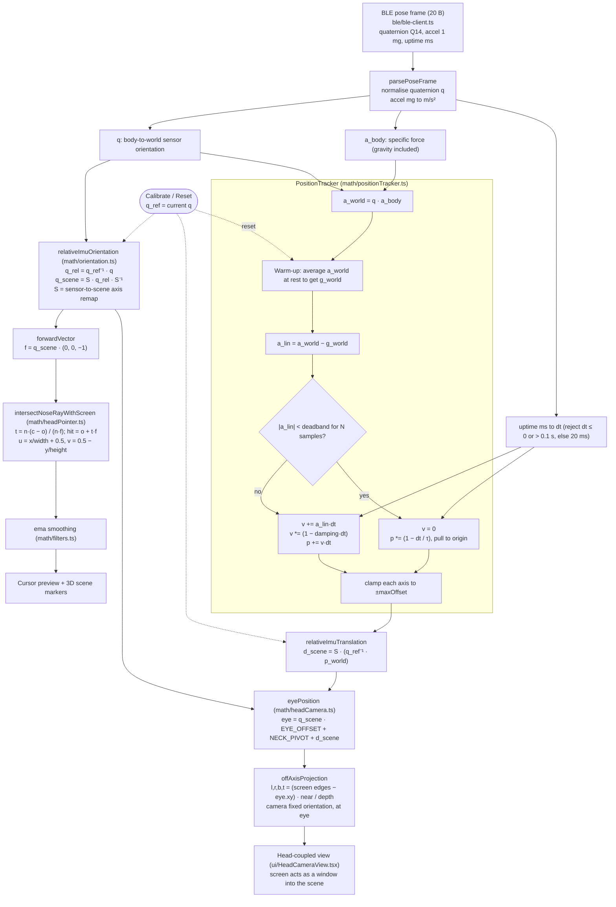

# Simulator math

Data flow from a BLE pose frame to the head-coupled 3D view and the cursor
projection. Module names refer to `simulator/src/`.

## Notes

- **Rotation** drives the cursor ray and the eye's arc around the neck pivot.
  It also rotates acceleration into the world frame so gravity can be removed.
- **Translation** is dead-reckoned from acceleration only. The deadband,
  zero-velocity update, damping, re-centring, and clamp keep drift bounded, so
  it only reflects short head movements.
- **Off-axis projection:** the virtual camera never rotates. The frustum is
  skewed so the screen rectangle stays the image plane, which produces the
  look-around parallax effect.
